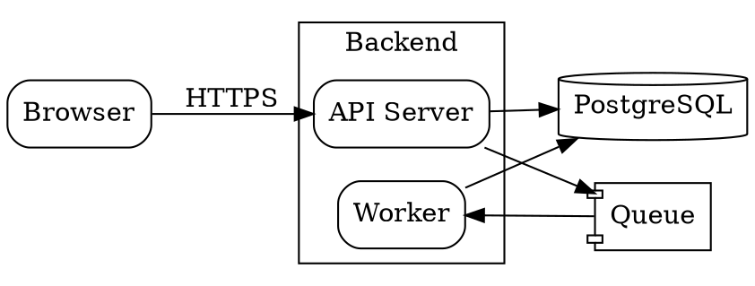
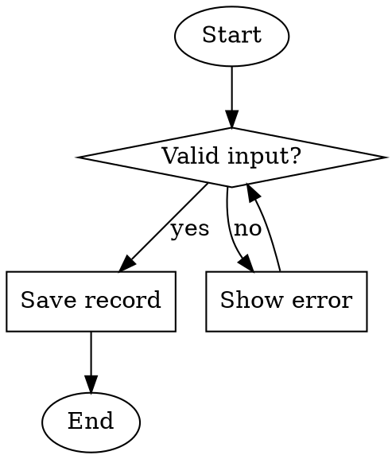

# Graphviz (DOT)

## Structure
`digraph G { ... }` for directed graphs (edges `->`), `graph G { ... }` for undirected (edges `--`).
Statements end with `;`. Global settings: `rankdir=LR;` (left to right) or `TB`,
`node [shape=box, style=rounded];`, `edge [fontsize=10];`.
IDs with spaces or symbols must be quoted: `"API Gateway"`.

## Nodes and edges
Node with attributes: `db [label="Orders DB", shape=cylinder];`. Shapes: `box`, `ellipse`,
`diamond` (decision), `cylinder` (database), `oval`, `circle`, `doublecircle`, `note`,
`component`, `folder`. Edges with labels: `a -> b [label="yes"];`. Chains: `a -> b -> c;`.
Styles: `style=dashed`, `color=red`.

## Clusters for architecture diagrams
Subgraphs whose name starts with `cluster` are drawn as boxes:
`subgraph cluster_backend { label="Backend"; api; worker; }`. Edges can cross clusters.

## Flowchart pattern
Use `shape=diamond` for decisions and labelled edges for branches; `shape=oval` for start/end.

## Common mistakes
Using `->` inside `graph` (must be `--`), unquoted labels with spaces, missing closing `}`,
`subgraph` names without the `cluster` prefix (no box is drawn), HTML labels need `<...>`
instead of quotes.
