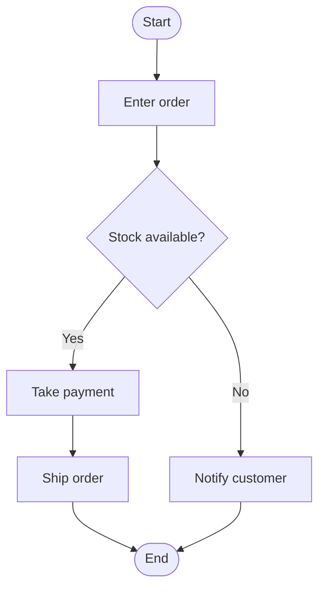
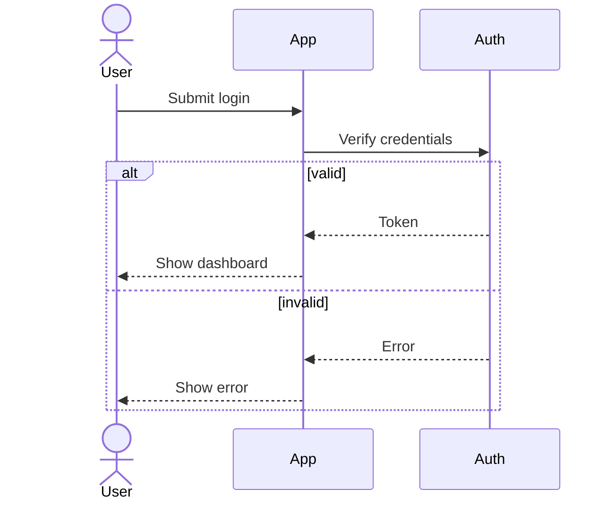
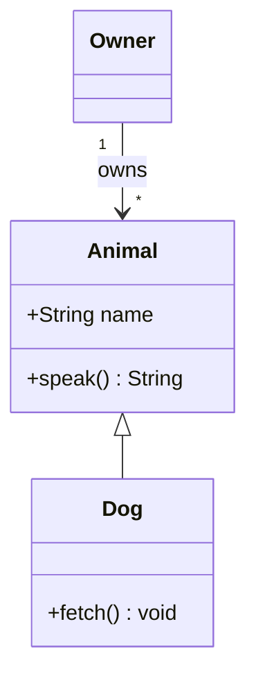
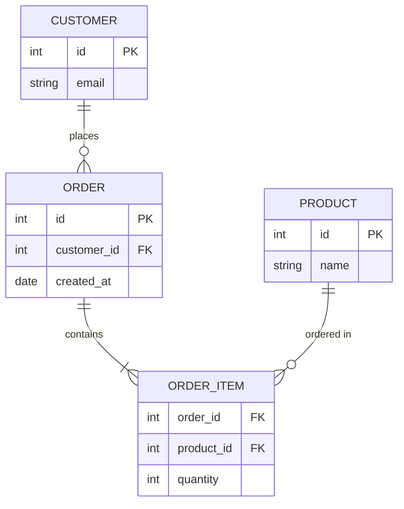
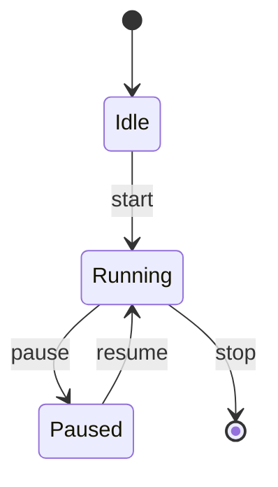

# Mermaid

## Structure and diagram type
The first line must name the diagram type: `flowchart TD` (or `graph TD`), `flowchart LR`,
`sequenceDiagram`, `classDiagram`, `erDiagram`, `stateDiagram-v2`, `gantt`, `pie`.
One diagram per code block. No HTML. Indentation is free but keep it consistent.

## Flowchart nodes and edges
Node id then shape: `A[Box]`, `B(Rounded)`, `C{Decision}`, `D[(Database)]`, `E((Circle))`.
Edges: `A --> B`, labelled `A -->|Yes| B` or `A -- Yes --> B`, dotted `A -.-> B`.
Group with `subgraph Title` ... `end`. Node ids must not contain spaces; put text in the label.
Quote labels that contain parentheses or special characters: `A["Save (draft)"]`.

## Sequence diagram
Declare `participant` or `actor` first. Sync message `A->>B: text`, reply `B-->>A: text`.
Use `activate`/`deactivate`, `Note over A,B: text`, and blocks `alt` / `else` / `end`,
`loop` / `end`, `opt` / `end`.

## Class diagram
`class Name { +Type field  +method() Type }`. Relations: inheritance `Animal <|-- Dog`,
composition `Car *-- Engine`, aggregation `Team o-- Player`, association `A --> B`,
dependency `A ..> B`. Cardinality: `Customer "1" --> "*" Order : places`.

## ER diagram
`erDiagram` then relationships `CUSTOMER ||--o{ ORDER : places`. Cardinality markers:
`||` exactly one, `o|` zero or one, `}o` / `o{` zero or more, `}|` / `|{` one or more.
The label after `:` is required. Attributes go in a block: type then name, then optional
`PK`, `FK`, `UK`. Entity names should not contain spaces.

## State diagram and common mistakes
`stateDiagram-v2`, start/end is `[*]`, transitions `Idle --> Running : start`. Composite states:
`state Running { ... }`. Common mistakes: missing type line, spaces in ids, using `->` instead of
`-->` in flowcharts, missing `end` for `subgraph`/`alt`/`loop`, missing `:` label in erDiagram.

