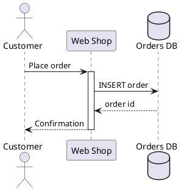
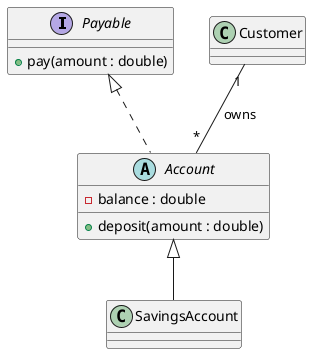
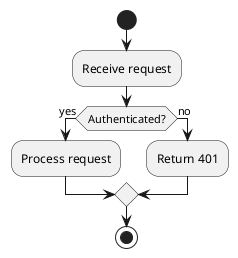
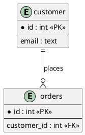

# PlantUML

## Structure
Every diagram is wrapped in `@startuml` and `@enduml`. The diagram type is detected from the
content (sequence, class, activity, state, use case, component). Use `title Text` for a title,
`left to right direction` to change layout. Quote names with spaces: `participant "Web App" as web`.

## Sequence diagram
Participants: `actor`, `participant`, `database`, `queue`, `boundary`, `control`, `entity`.
Messages: `A -> B : text` (sync), `A --> B : text` (reply), `A ->> B : text` (async).
Groups: `alt cond` / `else other` / `end`, `loop text` / `end`, `opt`, `par`.
Notes: `note right of A : text`. `activate A` / `deactivate A` show lifelines.

## Class diagram
`class Name { -type field  +method() }`, `abstract class`, `interface`, `enum`. Visibility:
`+` public, `-` private, `#` protected. Relations: `A <|-- B` inheritance, `A <|.. B` implements,
`A *-- B` composition, `A o-- B` aggregation, `A --> B` association, `A ..> B` dependency.
Multiplicity: `Customer "1" -- "*" Order : places`.

## Activity and state diagrams
Activity (new syntax): `start`, `:Action;`, `if (cond?) then (yes)` ... `else (no)` ... `endif`,
`while (cond?)` ... `endwhile`, `fork` / `fork again` / `end fork`, `stop`. Swimlanes: `|Lane|`.
State: `[*] --> Idle`, `Idle --> Busy : event`, `state Busy { ... }`.

## Use case, component and ER-style diagrams
Use case: `actor User`, `usecase (Login)`, `User --> (Login)`, `rectangle System { ... }`.
Component/deployment: `component`, `node`, `database`, `cloud`, `[A] --> [B]`.
ER-style: `entity name { * id : int <<PK>>  --  email : text }` and crow's foot links
`A ||--o{ B` (`|o`, `||`, `}o`, `}|`).

## Common mistakes
Missing `@startuml`/`@enduml`; mixing old and new activity syntax; forgetting `;` after
`:Action`; unbalanced `if/endif`, `alt/end`; Mermaid reply arrows like `-->>`; spaces in
alias names without quotes.
